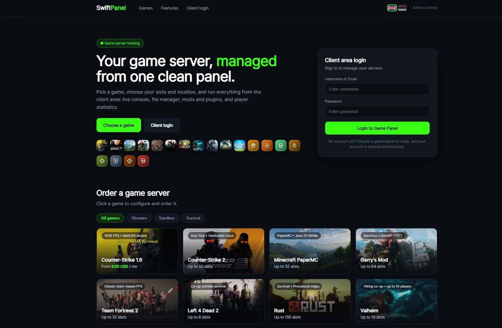

# SwiftPanel – Game Server Hosting Panel (Springs Docker Edition)

SwiftPanel is a web control panel for selling and running game servers.
Clients order a server, an admin approves it onto a node, and the server is
installed and run in a Docker container on that node. Everything is managed from
the browser: ordering, power controls, console, file manager, support tickets
and node monitoring.

Supported games: **Counter-Strike 1.6**, **Counter-Strike 2** and **Minecraft**
(Paper).




---

## Panel Version
0.0.1b

---

## Contents

- [Features](#features)
- [Architecture](#architecture)
- [Project structure](#project-structure)
- [Requirements](#requirements)
- [Installing the panel](#installing-the-panel)
- [Adding a node](#adding-a-node)
- [Database](#database)
- [How it works](#how-it-works)
- [Admin area](#admin-area)
- [Security notes and known issues](#security-notes-and-known-issues)
- [Backups and deployment](#backups-and-deployment)
- [Troubleshooting](#troubleshooting)

---

## Features

**Client portal**

- Order a server (game, location, name, slots) and get an email confirmation.
- Cancel pending orders; track order and server status.
- Live status badge per server (Checking / Installing / Online / Offline).
- Start, stop and restart from the dashboard.
- Console page with live log and command box (`server.php`).
- File manager: browse, edit, create, upload, extract `.zip`, delete (`files.php`).
- Support tickets and profile page.

**Admin area (`/admin`)**

- Add and monitor nodes with live CPU, RAM, disk, network and online status.
- Approve orders onto a chosen node (ports and install paths are allocated
  automatically).
- Create servers manually, manage all client servers, users, tickets.
- SMTP configuration with a test-email button.

**Nodes (Springs)**

- One-line installer that sets up Docker and the Springs agent.
- One container per game server, with memory limits.
- Minecraft: newest stable Paper build, Java 25 container.

---

## Architecture

```
┌──────────────┐        ┌────────────────────────────┐   HTTP + Bearer token   ┌───────────────────────┐
│ Browser      │──────► │ SwiftPanel (PHP + MySQL)   │ ──────────────────────► │ Node: Springs agent   │
│ client/admin │  HTTPS │ dashboard.php, files.php,  │   (default port 8085)   │ Python daemon         │
└──────────────┘        │ admin/*, ServerManager.php │                         │  └─ Docker containers │
                        └────────────────────────────┘                         │     (one per server)  │
                                                                               └───────────────────────┘
```

The panel never logs in to nodes over SSH. It calls the agent's REST API, using
the node's IP, API port and token stored in the `boxes` table. Full API
reference: [`docs/SPRINGS.md`](docs/SPRINGS.md).

---

## Project structure

```
/                           web root (panel)
├── auth.php                session start / login check for client pages
├── config.php              database settings, creates $pdo
├── mailer.php              SMTP mail helpers (sendSmtpMail, wrapPanelMail)
├── port_helper.php         allocateFreePort() for new servers
├── ServerManager.php       PHP client for the Springs agent API
├── dashboard.php           client dashboard: orders, servers, power actions
├── server.php              client console / server management page
├── files.php               client file manager
├── tickets.php             client support tickets
├── profile.php             client profile
├── node_stats_ajax.php     JSON telemetry endpoint used by admin/nodes.php
├── springs_install.php     node installer + agent source (served as a script)
├── assets/style.css        shared stylesheet
├── vendor/                 phpseclib, paragonie (legacy from the SSH era)
├── .well-known/            Let's Encrypt (ACME) validation
├── docs/SPRINGS.md         agent / API reference
└── admin/
    ├── index.php           redirects to nodes.php or login.php
    ├── login.php           admin login (?logout=1 to log out)
    ├── guard.php           admin-only session check
    ├── nodes.php           add / monitor / delete nodes
    ├── orders.php          approve or cancel orders
    ├── client_servers.php  client servers (?all=1 for everything)
    ├── servers.php         all servers
    ├── create_server.php   create a server manually
    ├── manage_server.php   per-server power, console, commands
    ├── users.php           users and own password
    ├── tickets.php         support tickets
    └── smtp.php            SMTP settings + test email
```

Client login/registration pages also live in the web root.

---

## Requirements

**Panel server**

- PHP 7.4+ (8.x recommended) with `pdo_mysql`, `curl`, `json`, `mbstring`.
- MySQL or MariaDB (the code uses `FIELD()`).
- Apache or Nginx with HTTPS.
- Outbound access from PHP to every node's API port.

**Nodes**

- Ubuntu/Debian with systemd, root access, `python3`, `curl`.
- Public IP for game ports; API port reachable from the panel server.
- Details: [`docs/SPRINGS.md`](docs/SPRINGS.md).

---

## Installing the panel

1. **Upload** the project to your web root.
2. **Create a database and user**, then edit `config.php` with the host, database
   name, user and password constants.
3. **Create the tables** (see [Database](#database)).
4. **Create the first admin.** Generate a hash and insert the user (adjust column
   names to your schema):

   ```bash
   php -r 'echo password_hash("CHOOSE_A_STRONG_PASSWORD", PASSWORD_DEFAULT), "\n";'
   ```

   ```sql
   INSERT INTO users (username, password_hash, email, role, email_verified)
   VALUES ('admin', '<hash from above>', 'you@example.com', 'admin', 1);
   ```

5. **Open `/admin/`**, log in, then go to **SMTP / Email** and configure mail
   (use *Send Test Email* to verify).
6. **Add your first node** (next section).

> If the `users` table is empty, `create_server.php` creates a default admin
> account with the password `admin123`. Never leave that in place: create your
> own admin first, or change the password immediately.

---

## Adding a node

1. In **Admin → Remote Nodes → Connect New Springs Node**, enter the node's name,
   IP, API port (default `8085`) and token. The page shows an install command.
2. Run that command as `root` on the node:

   ```bash
   curl -fsSL "https://YOUR-PANEL/springs_install.php?port=8085&token=YOUR_TOKEN" | bash
   ```

3. Within a few seconds the Nodes page shows the node **Online** with its CPU,
   RAM, disk and network figures.

The token must match `boxes.ssh_password` exactly. The installer installs Docker,
writes the agent, pulls the game images and starts the `springs` service. To
update a node later, run the same command again; running servers are not
stopped. See [`docs/SPRINGS.md`](docs/SPRINGS.md).

---

## Database

The code defines only the `orders` table itself; the others are created by you.
The list below is derived from the queries in the code. Add the columns your
install needs and pick suitable types.

| Table | Columns used by the code |
|-------|--------------------------|
| `users` | `id`, `username`, `password_hash`, `email`, `role` (`admin` / `client`), `email_verified`, `verify_token`, `created_at` |
| `boxes` (nodes) | `id`, `name`, `ip_address`, `ssh_port` (**agent API port**), `ssh_user`, `ssh_password` (**agent API token**), `location`, plus the port-range and extra-IP fields managed on the Nodes page |
| `servers` | `id`, `user_id`, `box_id`, `game` (`cs16` / `cs2` / `minecraft`), `name`, `ip_address`, `port`, `max_players`, `start_map_or_world`, `ram_mb`, `install_path`, `screen_name`, `status` (`installing` / `online` / `offline`) |
| `orders` | `id`, `user_id`, `game`, `location`, `server_name`, `slots`, `ram_mb`, `status` (`Pending` / `Approved` / `Cancelled`), `server_id`, `created_at` |
| `tickets` | `id`, `user_id`, `server_id`, `subject`, `status` (`Open` / `Answered` / `Closed`), `updated_at` |
| `ticket_replies` | `id`, `ticket_id`, `user_id`, `is_admin`, `message` |
| `smtp_settings` | one row with `id = 1`: `enabled`, `host`, `port`, `encryption`, `username`, `password`, `from_email`, `from_name` |

Note: the `CREATE TABLE IF NOT EXISTS orders` statement in the code has no
`location` column, but the dashboard inserts one. On a fresh database add it
(`ALTER TABLE orders ADD location VARCHAR(64) NULL;`) or placing an order fails.

---

## How it works

### Ordering and provisioning

1. **Client orders** on the dashboard: game, location, server name, slots
   (10–64). RAM is set automatically (2048 MB, or 4096 MB for CS2). The order is
   `Pending` and a confirmation email is sent.
2. **Admin approves** in *Orders* and picks a node. The panel then:
   - allocates a free game port on that node (`allocateFreePort`),
   - sets the install path `/var/lib/springs/volumes/<user>/<game>_<port>`,
   - sets the container name `<game>_<port>_<5 random hex>`,
   - inserts the server with status `installing`,
   - calls the agent's `/api/servers/install`,
   - marks the order `Approved` and emails the client.
3. **Installation** runs on the node in the background (SteamCMD for CS, a Paper
   download for Minecraft) and writes `install.log`.
4. **The dashboard polls** the server status. When the log shows
   `[Springs] Complete!` or `[Springs] Ready!`, the server becomes `offline`
   (installed, ready to start). Once running it shows `online`.
5. **Start / stop / restart** call the agent; a restart is stop, one second
   pause, start.

### Console and files

- The console page reads logs through the agent and sends commands to the
  container's standard input.
- The file manager works only inside the server's own folder; the agent
  enforces this (see [`docs/SPRINGS.md`](docs/SPRINGS.md)).

### Monitoring

`admin/nodes.php` requests `node_stats_ajax.php` for every node every 5 seconds.
That script uses `ServerManager::getSystemStats()` (`GET /api/stats` on the
node) and returns `{"status":"ok","stats":{...}}`, or an `offline`/`error`
status.

### Defaults per game

| Game | Start map / world | Expected binary |
|------|-------------------|-----------------|
| `cs16` | `de_dust2` | `./hlds_run` |
| `cs2` | `de_dust2` | `./game/bin/linuxsteamrt64/cs2` |
| `minecraft` | `world` | `server.jar` |

---

## Admin area

| Page | Purpose |
|------|---------|
| **Remote Nodes** (`nodes.php`) | Connect and delete nodes; generated install command; live telemetry; update location, port ranges and IPs |
| **Client Servers** (`client_servers.php`) | Servers of all clients (`?all=1` for every server) |
| **Create Server** (`create_server.php`) | Create a server manually for a user and node |
| **Users** (`users.php`) | Create `admin` or `client` users, delete users, verify an email manually, change your own password |
| **Orders** (`orders.php`) | Approve (choose a node) or cancel pending orders |
| **Support Tickets** (`tickets.php`) | Reply to tickets and set them `Open` / `Answered` / `Closed` |
| **SMTP / Email** (`smtp.php`) | Mail server settings and a test-email form |

Admin pages are protected by `guard.php`: not logged in goes to
`/admin/login.php`, and a non-admin goes to `/dashboard.php`.

---

## Security notes and known issues

- **Passwords** are stored with `password_hash`. The SMTP password and the node
  tokens are stored **in plaintext** in the database; protect database access and
  backups accordingly.
- **Panel-to-node traffic is plain HTTP.** Restrict each node's API port to the
  panel server's IP with a firewall (the installer opens it to everyone).
- **No CSRF protection** on the POST forms, and some actions (for example
  deleting a user) work through plain GET links. Add CSRF tokens.
- **No rate limiting** on the admin login.
- **Default admin** is created with `admin123` if the users table is empty
  (see [Installing the panel](#installing-the-panel)).
- **Rotate secrets** that were ever pasted into chats, tickets or screenshots
  (node tokens, database and SMTP passwords). Change a node's token in both the
  node's `SPRINGS_TOKEN` and `boxes.ssh_password`.
- `/api/servers/wipe` on the agent deletes any validated path outside a short
  blocklist; restricting it to `/var/lib/springs/volumes` is recommended.
- `vendor/phpseclib` is left over from the earlier SSH-based design and is no
  longer used by `ServerManager.php`.

---

## Backups and deployment

- Before changing anything, back up the web root and the database:

  ```bash
  mysqldump -u DB_USER -p DB_NAME > swiftpanel-$(date +%F).sql
  tar czf swiftpanel-files-$(date +%F).tgz /path/to/webroot
  ```

- After uploading a PHP file, check it is the file you meant and that it parses:

  ```bash
  head -n 3 file.php     # should start with <?php
  php -l file.php        # should say: No syntax errors detected
  ```

  A file saved under the wrong name (for example the node installer saved as
  `ServerManager.php`) breaks every page that loads it, and such errors are easy
  to miss in the browser.

---

## Troubleshooting

| Symptom | Check |
|---------|-------|
| Nodes page shows no telemetry or "Offline" | Open `node_stats_ajax.php?id=<node id>` as admin: it must return JSON starting with `{"status":"ok"`. Anything else (bash text, PHP error, login page) is the problem. Then test the node directly: `curl -H "Authorization: Bearer $TOKEN" http://NODE_IP:8085/api/stats` |
| Output starts with `#!/usr/bin/env bash` | A PHP file was overwritten with `springs_install.php`. Find it with `grep -l "Springs install aborted" *.php` (only `springs_install.php` should match) and restore the original |
| `401 Unauthorized` from a node | Token mismatch between `boxes.ssh_password` and the node's `SPRINGS_TOKEN` |
| Order approved but server stays "Installing" | Read `install.log` in the server's folder on the node; for Minecraft it says `FAILED: ...` if the Paper download failed |
| Minecraft will not start | See the Java 25 and entrypoint notes in [`docs/SPRINGS.md`](docs/SPRINGS.md) |
| Placing an order fails on a new database | Add the `location` column to `orders` (see [Database](#database)) |
| File manager shows an error | The node agent must be the current version (it provides `/api/files/*`); rerun the installer on the node |
| No emails sent | Admin → SMTP / Email → *Send Test Email* shows the exact SMTP error |

Agent-side problems (service, Docker, containers, logs): see
[`docs/SPRINGS.md`](docs/SPRINGS.md#troubleshooting).
